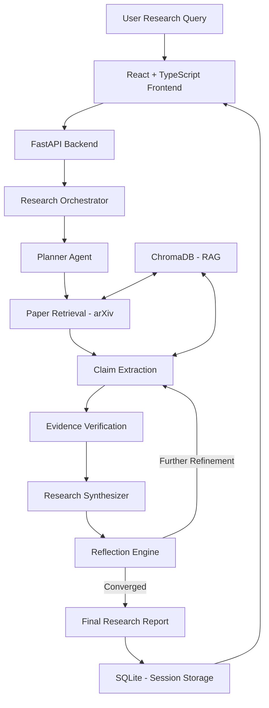

# MARS — Multi-Agent Reflective Synthesis

**An AI-powered research synthesis platform that uses multi-agent collaboration, retrieval-augmented generation, and iterative reflection to analyze, synthesize, and verify academic research.**

<p align="center">
  <a href="https://mars-f.onrender.com"><strong>Live Demo</strong></a>
  &nbsp;·&nbsp;
  <a href="https://github.com/Mohammed-Abdul-Rafe-Sajid/MARS-Multi-Agent-Reflective-Synthesis"><strong>Repository</strong></a>
</p>


---

## Overview

MARS (Multi-Agent Reflective Synthesis) is an intelligent research platform designed to streamline academic literature analysis.

Traditional research workflows often require manually searching through papers, identifying relevant findings, comparing claims, and validating supporting evidence. MARS automates this process through a coordinated multi-agent pipeline.

Given a research query, MARS retrieves relevant academic papers, extracts structured claims, evaluates supporting evidence, generates thematic summaries, and iteratively refines its findings through a reflection mechanism.

The goal is to make research synthesis more structured, traceable, and evidence-driven.

## Key Features

- **Multi-Agent Research Pipeline:** Specialized agents handle research planning, paper retrieval, claim extraction, synthesis, and verification.
- **Academic Paper Retrieval:** Retrieves relevant research papers through the arXiv API.
- **Claim Extraction:** Identifies research claims and organizes them into a structured representation.
- **Evidence Verification:** Evaluates claims based on their supporting evidence and assigns support-strength classifications.
- **Retrieval-Augmented Generation:** Uses ChromaDB for vector-based retrieval and context-aware research synthesis.
- **Reflective Refinement:** Iteratively reviews and refines extracted claims to improve consistency and convergence.
- **Research Analytics:** Tracks papers, extracted claims, evidence distribution, and reflection iterations.
- **Interactive Dashboard:** Provides research reports, progress tracking, metrics, and session history.
- **Persistent Research Sessions:** Stores research sessions and their associated results for later access.

## Architecture

MARS follows a modular architecture consisting of a React frontend, FastAPI backend, multi-agent orchestration layer, retrieval and verification components, and persistent storage.



### Research Pipeline

| Component | Responsibility |
|---|---|
| Planner Agent | Decomposes research queries into structured themes. |
| Paper Retriever | Retrieves relevant academic papers from arXiv. |
| Claim Graph Builder | Extracts claims and structures their supporting evidence. |
| Verifier Agent | Evaluates claim support and evidence consistency. |
| Synthesizer Agent | Produces thematic summaries and comparative findings. |
| Reflection Engine | Iteratively refines research outputs and monitors convergence. |

The reflection mechanism allows the pipeline to revisit and refine its findings rather than relying on a single generation pass.

## Technology Stack

| Layer | Technologies |
|---|---|
| Frontend | React, TypeScript |
| Backend | Python, FastAPI, Uvicorn |
| AI / LLM | OpenAI API |
| Retrieval | arXiv API |
| RAG | ChromaDB |
| Database | SQLite, SQLAlchemy |
| Embeddings | OpenAI Embeddings |
| Validation | Pydantic |
| HTTP Client | HTTPX |

## Getting Started

### Prerequisites

- Python 3.12+
- Node.js and npm
- OpenAI API key
- Git

### Installation

**1. Clone the repository**

```bash
git clone https://github.com/Mohammed-Abdul-Rafe-Sajid/MARS-Multi-Agent-Reflective-Synthesis.git

cd MARS-Multi-Agent-Reflective-Synthesis
```

**2. Set up the backend**

```bash
python -m venv .venv
```

Activate the environment:

```bash
# Windows
.venv\Scripts\activate

# macOS / Linux
source .venv/bin/activate
```

Install dependencies:

```bash
pip install -r backend/requirements.txt
```

**3. Configure environment variables**

Create your environment file:

```bash
# Windows
copy backend\.env.example backend\.env

# macOS / Linux
cp backend/.env.example backend/.env
```

Add your OpenAI API key to `backend/.env`:

```env
OPENAI_API_KEY=your_openai_api_key
```

Configure other application settings as required.

**4. Set up the frontend**

```bash
cd frontend
npm install
```

### Running Locally

Start the backend:

```bash
cd backend
python -m uvicorn main:app --reload --host 0.0.0.0 --port 8000
```

Start the frontend in a separate terminal:

```bash
cd frontend
npm start
```

Open the application at:

```text
http://localhost:3000
```

The backend API runs on port `8000`.

## API Endpoints

The backend exposes REST endpoints for managing research sessions.

| Method | Endpoint | Description |
|---|---|---|
| POST | `/research/launch` | Launch a research session. |
| GET | `/research/status/{id}` | Retrieve research progress. |
| GET | `/research/report/{id}` | Retrieve the generated research report. |
| GET | `/research/metrics/{id}` | Retrieve research analytics. |
| GET | `/research/history` | Retrieve previous research sessions. |

## Project Structure

```text
MARS-Multi-Agent-Reflective-Synthesis/
│
├── backend/
│   ├── agents/
│   │   ├── planner.py
│   │   ├── claim_graph_builder.py
│   │   ├── synthesizer.py
│   │   ├── verifier.py
│   │   └── reflection_engine.py
│   │
│   ├── api/
│   │   ├── routes.py
│   │   └── orchestrator.py
│   │
│   ├── retrieval/
│   ├── rag/
│   ├── memory/
│   ├── evaluation/
│   ├── utils/
│   │
│   ├── config.py
│   ├── main.py
│   └── requirements.txt
│
├── frontend/
│   ├── public/
│   ├── src/
│   │   ├── components/
│   │   ├── pages/
│   │   ├── hooks/
│   │   ├── api/
│   │   └── types/
│   └── package.json
│
├── chromadb_store/
├── .env.example
├── .gitignore
├── start-production.sh
├── start-production.ps1
└── README.md
```

## Configuration

MARS supports configuration through environment variables.

| Variable | Description |
|---|---|
| `OPENAI_API_KEY` | OpenAI API authentication key. |
| `LLM_MODEL` | Language model used for research synthesis. |
| `LLM_MAX_TOKENS` | Maximum output tokens. |
| `MAX_PAPERS_PER_QUERY` | Maximum papers retrieved per query. |
| `TOP_K_RAG_CHUNKS` | Number of retrieval context chunks. |
| `MAX_ITERATIONS` | Maximum reflection iterations. |
| `DEFAULT_ABLATION_MODE` | Research execution mode (`api_only`, `rag_only`, or `both`). |
| `CHROMA_PERSIST_DIR` | ChromaDB persistence directory. |
| `DATABASE_URL` | Database connection string. |

Refer to `.env.example` for the complete configuration options.

## Contributing

Contributions, suggestions, and improvements are welcome.

1. Fork the repository.
2. Create a feature branch.
3. Implement and test your changes.
4. Commit your changes with a descriptive message.
5. Submit a pull request.

For bug reports and feature requests, use [GitHub Issues](https://github.com/Mohammed-Abdul-Rafe-Sajid/MARS-Multi-Agent-Reflective-Synthesis/issues).

## License

This project is licensed under the MIT License. See the [LICENSE](LICENSE) file for details.

---

**MARS — Making academic research synthesis more systematic, transparent, and evidence-driven.**
